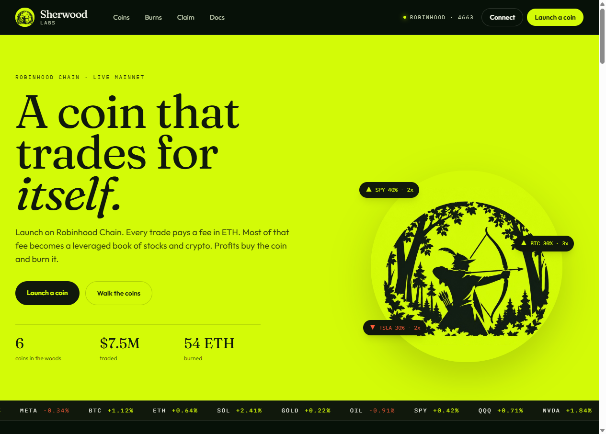
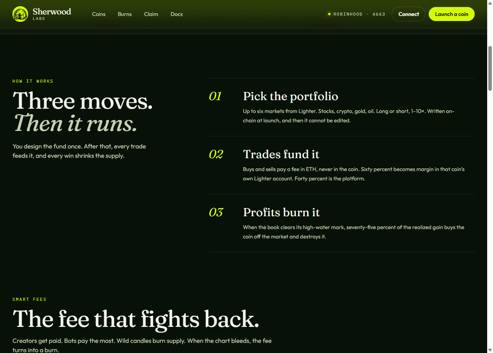
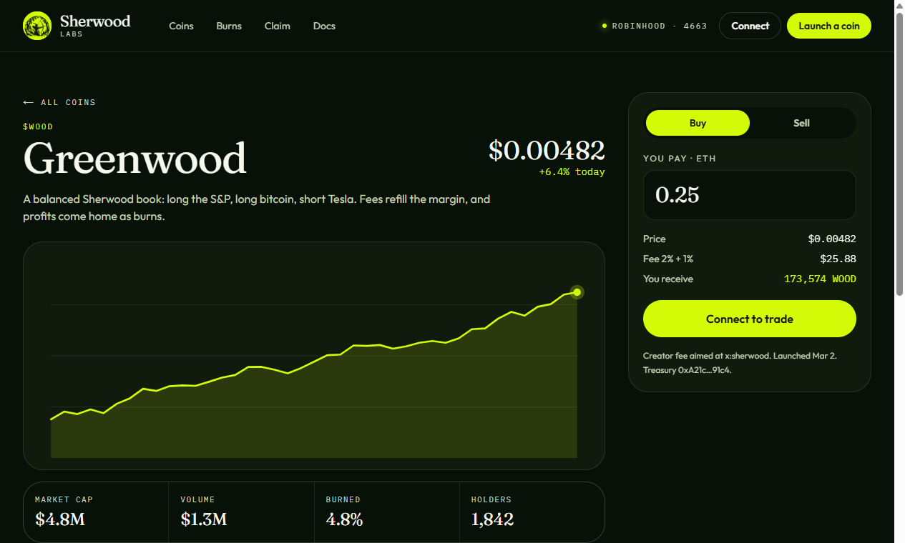
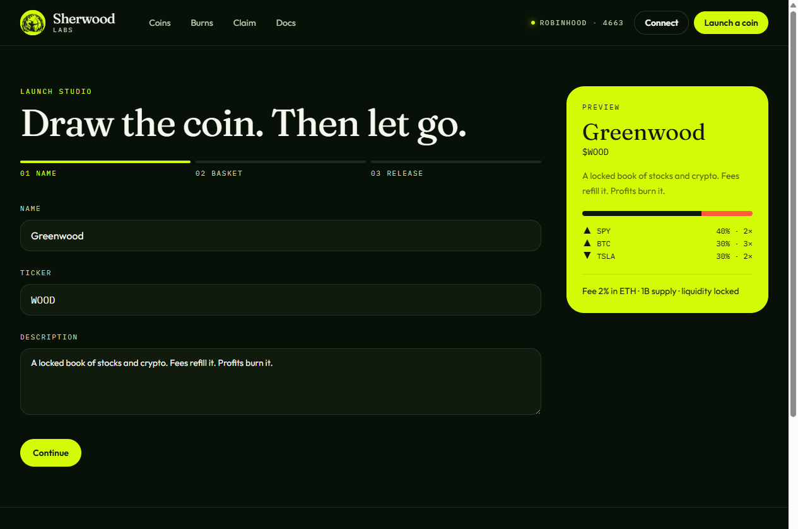

# Sherwood

**Coins backed by their own leveraged portfolio, on Robinhood Chain.**

Sherwood is a coin launchpad on Robinhood Chain. Every coin trades against native ETH in a Uniswap v4 pool and funds its own trading portfolio. A Uniswap v4 hook takes each coin's trading fee in ETH. Most of that fee becomes margin for leveraged perpetual positions on [Lighter](https://lighter.xyz), and realized profits are used to buy back and burn the coin.

- **Free to launch.** Creators need no ETH. The full supply is deposited as single-sided liquidity.
- **Liquidity locked forever.** The factory owns the position and has no way to remove it.
- **Fees in ETH, never in tokens.** The creator sets a fixed fee between 1% and 5%, charged on both buys and sells.
- **A transparent basket.** Each coin stores its strategy on-chain (1–6 markets, long or short, 1–10×), and it cannot be changed after launch.
- **Deflationary by design.** 75% of realized trading profit buys back the coin and burns it.



---

## How it works

```
                           Robinhood Chain (4663)
 trader ──ETH──► Uniswap v4 ETH/COIN pool ── LeveredHook takes fee in ETH ──► LeveredTreasury
                                                                               │ 40% → platform
                                                                               │ 60% → margin
                                      Uniswap v4 ETH/USDG pool ◄── depositMargin┘
                                                 │ USDG
                                                 ▼
                                Lighter deposit contract → coin's trading sub-account
                                                                               │ perps: SPY, BTC, ETH…
                     buyback & burn ◄── ETH ◄── v4 ◄── USDG ◄── 75% of realized profit
```

1. **Launch.** `createCoin` mints a fixed supply of 1,000,000,000 tokens and adds all of it as single-sided liquidity to a Uniswap v4 ETH/COIN pool. The coin's basket and fee rate are stored on-chain.
2. **Trade.** `LeveredHook` takes the fee from the ETH side of every swap, including swaps routed through other apps. Anyone can call `collectFees` to send accrued fees to the coin's treasury.
3. **Split.** The treasury sends 40% to the platform and keeps 60% as trading margin. On current hooks, a separate 1% creator fee is paid in ETH on top of the coin's fee. It can go to the launcher's wallet, or to an X, GitHub, or Discord account named at launch. That aim is locked.
4. **Margin.** `depositMargin` swaps ETH to USDG through Uniswap v4 and deposits it into Lighter for the coin's sub-account.
5. **Trading.** The keeper sizes each position as `equity × weight × leverage` and rebalances when positions drift more than 10% from their targets. Equity perps on Lighter trade 24/5. Outside those hours the keeper waits, then opens or rebalances stock legs when the session resumes.
6. **Buyback and burn.** When the portfolio is 10% above its high-water mark, the keeper realizes half of that gain and sends 75% of it back on-chain. There, `buybackAndBurn` buys the coin and burns it. The rest stays in the portfolio.



### Fees that react

A coin's own fee never goes above 5%, so a trade costs at most 6% once the creator's 1% is included. On current hooks the fee also reacts to the market:

| Rule | What happens |
| --- | --- |
| Creator fee | Every buy and sell pays 1% in ETH to the creator, on top of the coin's fee. |
| Defend mode | If price falls 20% below its high, the coin's share of every fee goes to buyback for six hours. Traders pay nothing extra. |
| Bot tax | Selling within 15 seconds of your own buy pays the full 5% coin fee. |
| Volatility | The fee rises with the move, up to an extra 2%, and fades as the market calms. That extra buys the coin and burns it. |
| Solana route | A buy that arrives from Solana pays the same fee. That fee is routed to burns instead of new margin. |

Coins launched before the current hook keep the rules they launched with.

## This interface

This folder is the Sherwood web app: Next.js, TypeScript, and Tailwind. It is the place to read the product, browse coins, open a coin, and walk through launch, burns, and claims.

**A coin.** Price, history, the locked basket, and a buy or sell ticket.



**Launch.** Name the coin, compose the basket, set the fee, and release it. A live preview sits beside the form. Weights must add up to 100%. A coin can hold at most six markets.



| Route | What it is |
| --- | --- |
| `/` | Product introduction, fee rules, and featured coins |
| `/coins` | Searchable market, with the largest burners first |
| `/coin/[slug]` | Chart, basket, recent activity, and a trade ticket |
| `/launch` | Three-step launch studio |
| `/burns` | Buyback ledger |
| `/claim` | Look up a creator fee by X, GitHub, or Discord handle |
| `/docs` | How the protocol works, with mainnet addresses |
| `/whitepaper` | Longer account of the design |

Launch, trade, and claim in this app run in the browser so the interface can be walked end to end. Nothing in this folder sends a transaction. Homepage totals are illustrative. The contract addresses below, and on the docs page, are the Robinhood Chain mainnet deployments.

## Repository layout

Sherwood lives next to the rest of the protocol in this repository.

| Path | Description |
| --- | --- |
| [`../contracts/`](../contracts) | Solidity smart contracts (Foundry) |
| [`../keeper/`](../keeper) | Python service that collects fees, manages margin, trades on Lighter, and runs buybacks |
| [`../web/`](../web) | Earlier Next.js app |
| [`../abi/`](../abi) | Contract ABIs used by the keeper |
| [`./`](.) | This Sherwood interface |

### App layout

| Path | Description |
| --- | --- |
| `src/app` | Routes: home, coins, coin, launch, burns, claim, docs, whitepaper |
| `src/components` | Header, footer, coin cards, trade ticket, launch studio |
| `src/lib` | Preview market data, formatting, and copy |
| `public` | Sherwood Labs mark |
| `docs/screenshots` | Images used in this README |

### Contracts

| Contract | Role |
| --- | --- |
| `LeveredFactory` | Launches coins, creates and seeds their v4 pools, and holds the locked liquidity |
| `LeveredHook` | Uniswap v4 hook that charges the creator-set trading fee in ETH |
| `LeveredTreasury` | Per-coin treasury that splits fees, deposits margin, and runs buyback-and-burn |
| `LeveredRouter` | Simple buy/sell router for ETH ⇄ coin swaps |
| `LeveredToken` | Fixed-supply, burnable ERC-20 |
| Metadata | Optional coin profile: logo, description, and social links |

## Deployments

**Robinhood Chain mainnet (chain ID 4663)**

| Contract | Address |
| --- | --- |
| LeveredFactory | [`0x019e1242e8d4b76Bc0A1dca1B912daA04323d355`](https://robinhoodchain.blockscout.com/address/0x019e1242e8d4b76Bc0A1dca1B912daA04323d355) |
| LeveredHook | [`0xf6fbd259fd80be4dc9131efd7ed6f2089aa6e0cc`](https://robinhoodchain.blockscout.com/address/0xf6fbd259fd80be4dc9131efd7ed6f2089aa6e0cc) |
| LeveredRouter | [`0x15e2db8885a9fa6e5d79c4875687898fdf4e88e3`](https://robinhoodchain.blockscout.com/address/0x15e2db8885a9fa6e5d79c4875687898fdf4e88e3) |
| Metadata | [`0xa55D5E6E5e80C22Ad09e7743E95D2152C09d800B`](https://robinhoodchain.blockscout.com/address/0xa55D5E6E5e80C22Ad09e7743E95D2152C09d800B) |
| Uniswap v4 PoolManager | [`0x8366a39CC670B4001A1121B8F6A443A643e40951`](https://robinhoodchain.blockscout.com/address/0x8366a39CC670B4001A1121B8F6A443A643e40951) |

## Uniswap v4 hook

`LeveredHook` uses the `beforeSwap`, `afterSwap`, `beforeSwapReturnDelta`, and `afterSwapReturnDelta` permissions.

- The fee is charged **only on the ETH side** of a swap and never on the token side.
- If ETH is the specified amount, the fee is taken in `beforeSwap`. If ETH is the unspecified amount, it is taken in `afterSwap`.
- The fee rate is fixed for each pool when the pool is registered, capped at 5%, and cannot be changed afterwards.
- Accrued fees are held as PoolManager ERC-6909 claims. Anyone can call `collectFees` to pay them out.
- The hook does not use dynamic fees and does not change liquidity or price.

## Safety and guardrails

- Liquidity is permanently locked in each coin's pool.
- Coin baskets and fee rates cannot be changed after launch.
- Margin can only go to Lighter through the configured pool. Platform fees can only go to the platform wallet. Returned profit can only be used for buyback-and-burn.
- `marginCapPerCoin` caps how much margin each coin can deposit over its lifetime.
- Changing where margin is sent requires a 2-day timelock (`proposeMarginConfig` → `executeMarginConfig`).
- The owner can pause new launches and new margin deposits.
- The keeper stops trading and closes all positions if a coin's portfolio falls 35% from its peak. At 2× leverage that is roughly a 17% move in the underlying, well before liquidation. What remains stays in the coin's account. Burns only come from profit above the previous high.

**Trust model.** The contracts limit what the keeper can do on-chain. Positions on Lighter are managed by the operator's account, so holders rely on the operator for off-chain trading.

## Getting started

### Requirements

- Node.js 20 or newer
- npm

The contracts and the keeper live in the parent repository and have their own setup. This folder only needs Node.

### Sherwood

```bash
cd sherwood
npm install
npm run dev
```

Open [http://localhost:3000](http://localhost:3000).

```bash
npm run build    # production build
npm run lint     # lint
```

### Stack

- [Next.js](https://nextjs.org/) 16, App Router
- React 19
- TypeScript
- Tailwind CSS 4

## Disclaimer

This software is experimental. Leveraged trading carries significant risk, including the total loss of margin. Nothing in this repository is financial advice. The contracts have not been independently audited. Use at your own risk.
